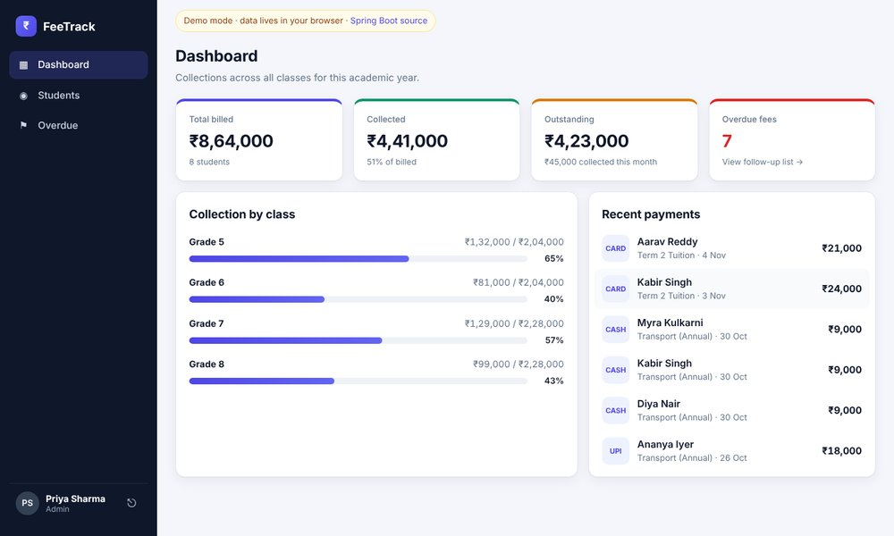
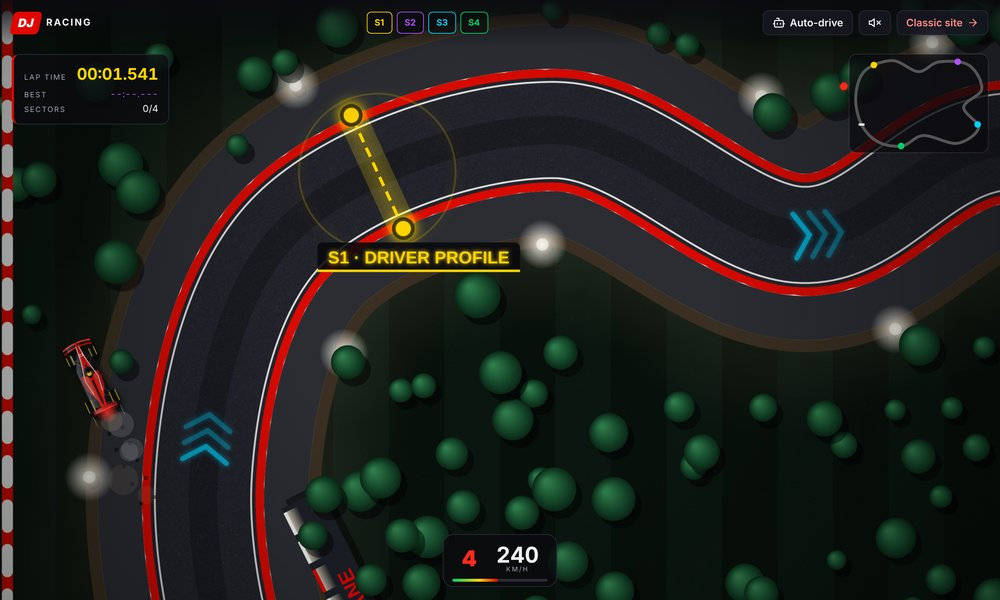

  

  

  
  
  

---

### 👋 About me

**Full Stack Developer (SDE III) at Knowvo, Bengaluru** · 3.9 years building School ERP and EdTech products end to end.

- 🏎️ Grew from **intern to SDE III** in 3.5 years
- 💳 Built **payment flows** with Razorpay, PhonePe UPI and GrayQuest EMI, including webhooks and fee settlement
- 🏫 Shipped **admissions and fee modules** for a multi-school ERP, from Angular screens to Spring Boot APIs
- ⚡ Built a **B2B portal on Angular 21** with standalone components and signals
- 📍 Open to **Full Stack / Angular + Java** roles in Bengaluru, Hyderabad, Pune, Chennai or remote

### 🛠️ Tech stack

   
  

**Also:** RxJS · NgRx · Signals · Spring Security + JWT · Spring Data JPA · Flyway · Playwright · Jasmine/Karma · Bitbucket Pipelines · Razorpay · PhonePe UPI · GrayQuest EMI · Webhooks

### 🚀 Featured projects

<table>
  <tr>
    <td width="50%" valign="top">
      
      <h4><a href="https://github.com/jagadeeshdammu/fee-payment-tracker">💳 Ledgr · School Fee Tracker</a></h4>
      
School fee app with JWT roles (admin / accountant). Payments can't exceed the balance or reuse a transaction reference, and optimistic locking stops two clerks from overwriting each other. Has a filterable payments ledger with CSV export, printable receipts, one-tap WhatsApp reminders for overdue fees and billing a whole class at once. Hand-built SVG charts, GSAP motion and dark mode, with tests in CI.

      

        
        
        
        
        
      

      <a href="https://jagadeeshdammu.github.io/fee-payment-tracker/"><b>▶ Live demo</b></a> · <a href="https://github.com/jagadeeshdammu/fee-payment-tracker">Code</a>
    </td>
    <td width="50%" valign="top">
      
      <h4><a href="https://github.com/jagadeeshdammu/f1-portfolio">🏁 F1 Portfolio Game</a></h4>
      
My portfolio as a playable top-down F1 game. Drive through 4 sector gates to unlock my profile, skills, projects and contact. The canvas game loop runs outside NgZone, and every push auto-deploys through GitHub Actions.

      

        
        
        
        
      

      <a href="https://jagadeeshdammu.github.io/f1-portfolio/"><b>▶ Play it</b></a> · <a href="https://github.com/jagadeeshdammu/f1-portfolio">Code</a>
    </td>
  </tr>
</table>

Also: [Angular Student Management System](https://github.com/jagadeeshdammu/angular-student-management-system), a CRUD app with reactive forms, routing and services.

### 💼 What I've built at work (code is private)

| Module | What I did |
|---|---|
| **Payments** | Integrated EMI and UPI gateways, handled webhooks idempotently, mapped fee heads to the right school bank accounts |
| **Admissions & fees** | End-to-end modules for a multi-school ERP: Angular screens to Spring Boot REST APIs |
| **B2B portal** | Built from scratch on Angular 21: standalone components, signals, JWT-secured routes |
| **Production fixes** | Traced and fixed a fee-allocation bug that routed money to the wrong trust accounts |
| **Client platforms** | Test-prep platforms, usage dashboards and PDF reports for EdTech clients |

### 📊 GitHub activity

  <picture>
    <source media="(prefers-color-scheme: dark)" srcset="https://raw.githubusercontent.com/jagadeeshdammu/jagadeeshdammu/output/github-snake-dark.svg">
    <source media="(prefers-color-scheme: light)" srcset="https://raw.githubusercontent.com/jagadeeshdammu/jagadeeshdammu/output/github-snake.svg">
    
  </picture>

---

<i>🏁 Lights out and away we go. Let's build something together.</i>

